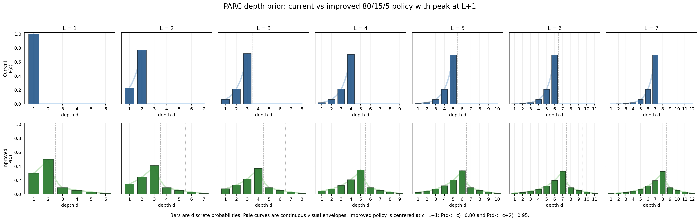

# BabyTheorist Depth Distribution

This note compares the current level-depth prior with the proposed prior for
BabyTheorist generation. The goal is to make the level id a curriculum signal, not a
hard upper bound on program depth.



## Previous Policy

Earlier generation sampled depth from `1..L` with a right-truncated geometric
distribution:

```text
P(d | L, gamma) proportional to gamma^(L-d), d in {1, ..., L}
gamma = 0.3
```

This makes `d=L` the mode, but it also makes `L` a strict maximum depth. A
model can therefore use the level id as a shortcut: for level `L`, no task can
have depth greater than `L`.

## Proposed Policy

The proposed policy is a quantile-calibrated piecewise geometric depth prior.
For level `L`, define the center depth as:

```text
c = L + 1
```

The distribution then assigns:

```text
P(d <= c)     = 0.80
P(d <= c + 2) = 0.95
P(d > c + 2)  = 0.05
```

Since `c=L+1`, this is equivalently:

```text
P(d <= L + 1) = 0.80
P(d <= L + 3) = 0.95
P(d > L + 3)  = 0.05
```

Within these regions, probabilities decay geometrically away from the center.
Let:

```text
alpha = 0.60   # left-side retention factor
beta  = 0.60   # shoulder split between c+1 and c+2
rho   = 0.35   # hard-tail retention factor
```

The left region is normalized over `d in {1, ..., c}`:

```text
A_c = sum_{j=1}^{c} alpha^(c-j)

P(d | L) = 0.80 * alpha^(c-d) / A_c,       d <= c
```

The near-harder shoulder receives 15% mass:

```text
P(c+1 | L) = 0.15 / (1 + beta)
P(c+2 | L) = 0.15 * beta / (1 + beta)
```

The hard tail receives 5% mass and decays geometrically:

```text
P(d | L) proportional to rho^(d-(c+3)),    d >= c+3
```

The mathematical prior is naturally an infinite geometric tail. Generation
uses a finite tail truncation so the sampler and dominant pools have a maximum
depth; with `tail_truncation=6`, the tail is normalized over
`d in {c+3, ..., c+8}`.

## Interpretation

This changes the benchmark story from:

```text
Level L means depth is at most L.
```

to:

```text
Level L has peak depth L+1.
Most tasks are no deeper than L+3.
A small hard tail allows deeper tasks to appear.
Easier tasks remain represented, but the left tail decays quickly.
```

The one-step center shift avoids making `level=1` degenerate. Under the older
`center=L` version, `P(d<=L)=0.80` forced level 1 to place 80% probability on
depth 1. With `center=L+1`, level 1 peaks at depth 2 while still preserving a
simple rule for every level.

## Example Mass

With `alpha=0.60`, `beta=0.60`, `rho=0.35`, and `tail_truncation=6`:

```text
L=1, center=2: P(d<=L)=0.300, P(d<=L+1)=0.800, P(d<=L+3)=0.950, P(peak)=0.500
L=2, center=3: P(d<=L)=0.392, P(d<=L+1)=0.800, P(d<=L+3)=0.950, P(peak)=0.408
L=3, center=4: P(d<=L)=0.432, P(d<=L+1)=0.800, P(d<=L+3)=0.950, P(peak)=0.368
L=4, center=5: P(d<=L)=0.453, P(d<=L+1)=0.800, P(d<=L+3)=0.950, P(peak)=0.347
L=5, center=6: P(d<=L)=0.464, P(d<=L+1)=0.800, P(d<=L+3)=0.950, P(peak)=0.336
L=6, center=7: P(d<=L)=0.471, P(d<=L+1)=0.800, P(d<=L+3)=0.950, P(peak)=0.329
L=7, center=8: P(d<=L)=0.475, P(d<=L+1)=0.800, P(d<=L+3)=0.950, P(peak)=0.325
```

## Paper Wording

```text
We sample program depth from a quantile-calibrated piecewise geometric prior.
For level L, the prior is centered at depth L+1. It assigns 80% probability
mass to depths no greater than L+1, 15% to the near-harder shoulder at depths
L+2 and L+3, and 5% to a geometrically decaying hard tail beyond L+3. This
keeps the curriculum level informative while preventing it from acting as a
hard upper bound on program depth.
```

## Visualization Code

```python
from pathlib import Path

import matplotlib.pyplot as plt
import numpy as np


def current_geometric(L, gamma=0.3, max_depth=None):
    depths = np.arange(1, max_depth + 1)
    probs = np.zeros_like(depths, dtype=float)
    support = depths <= L
    weights = gamma ** (L - depths[support])
    probs[support] = weights / weights.sum()
    return depths, probs


def proposed_piecewise_geometric(
    L,
    *,
    alpha=0.60,
    beta=0.60,
    rho=0.35,
    mass_left=0.80,
    mass_shoulder=0.15,
    mass_tail=0.05,
    tail_truncation=6,
):
    center = L + 1
    depths = np.arange(1, center + 2 + tail_truncation + 1)
    probs = np.zeros_like(depths, dtype=float)

    left = depths <= center
    left_weights = alpha ** (center - depths[left])
    probs[left] = mass_left * left_weights / left_weights.sum()

    probs[depths == center + 1] = mass_shoulder / (1.0 + beta)
    probs[depths == center + 2] = mass_shoulder * beta / (1.0 + beta)

    tail = depths > center + 2
    tail_weights = np.array(
        [rho ** (d - (center + 3)) for d in depths[tail]],
        dtype=float,
    )
    probs[tail] = mass_tail * tail_weights / tail_weights.sum()
    return depths, probs


def continuous_envelope(depths, probs, xs):
    eps = 1e-12
    logp = np.log(np.maximum(probs, eps))
    ys = np.exp(np.interp(xs, depths, logp))
    ys[xs < depths.min()] = 0.0
    ys[xs > depths.max()] = 0.0
    return ys


levels = list(range(1, 8))
show_extra = 4

fig, axes = plt.subplots(2, len(levels), figsize=(22, 6.4), sharey=True)
fig.suptitle(
    "BabyTheorist depth prior: current vs proposed policy with peak at L+1",
    fontsize=16,
    y=1.03,
)

for col, L in enumerate(levels):
    center = L + 1
    max_depth = center + show_extra
    xticks = np.arange(1, max_depth + 1)
    xs = np.linspace(1, max_depth, 400)

    ax = axes[0, col]
    d, p = current_geometric(L, max_depth=max_depth)
    current_curve = np.zeros_like(xs)
    current_support = xs <= L
    denom = sum(0.3 ** (L - j) for j in range(1, L + 1))
    current_curve[current_support] = 0.3 ** (L - xs[current_support]) / denom
    ax.plot(xs, current_curve, color="#BFD4E8", linewidth=3.0, zorder=1)
    ax.bar(d, p, color="#2F5F8F", edgecolor="#1F2D3A", width=0.72, zorder=2)
    ax.axvline(L + 0.5, color="#222222", linestyle="--", linewidth=1, alpha=0.35)
    ax.set_title(f"L = {L}")
    ax.set_xlabel("depth d")
    ax.set_xticks(xticks)
    ax.set_xlim(0.35, max_depth + 0.65)
    ax.set_ylim(0, 1.02)
    ax.grid(alpha=0.20)
    if col == 0:
        ax.set_ylabel("Current\nP(d)")

    ax = axes[1, col]
    d, p = proposed_piecewise_geometric(L)
    visible = d <= max_depth
    ax.plot(
        xs,
        continuous_envelope(d[visible], p[visible], xs),
        color="#C7E6C3",
        linewidth=3.0,
        zorder=1,
    )
    shown = d <= max_depth
    ax.bar(
        d[shown],
        p[shown],
        color="#2E7D32",
        edgecolor="#1E3B20",
        width=0.72,
        zorder=2,
    )
    ax.axvline(center + 0.5, color="#222222", linestyle="--", linewidth=1, alpha=0.35)
    ax.axvline(center + 2.5, color="#222222", linestyle=":", linewidth=1, alpha=0.35)
    ax.set_xlabel("depth d")
    ax.set_xticks(xticks)
    ax.set_xlim(0.35, max_depth + 0.65)
    ax.set_ylim(0, 1.02)
    ax.grid(alpha=0.20)
    if col == 0:
        ax.set_ylabel("Proposed\nP(d)")

fig.tight_layout()
fig.savefig(
    Path("docs/assets/depth_distribution_current_vs_proposed.png"),
    dpi=180,
    bbox_inches="tight",
)
```
